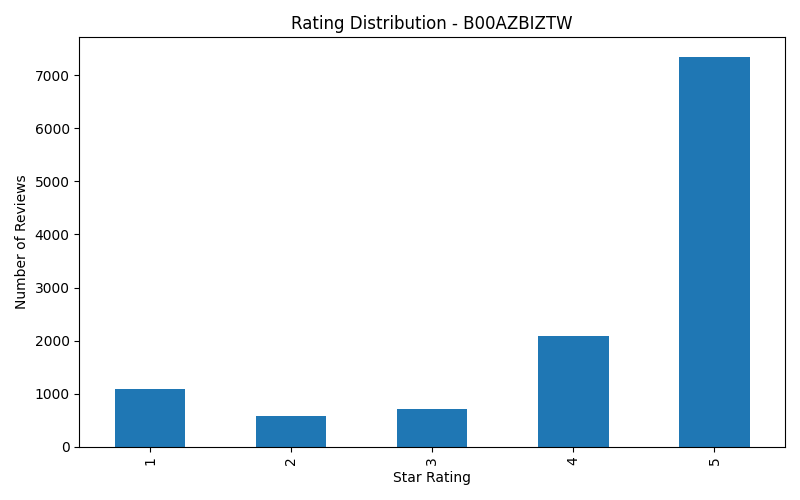
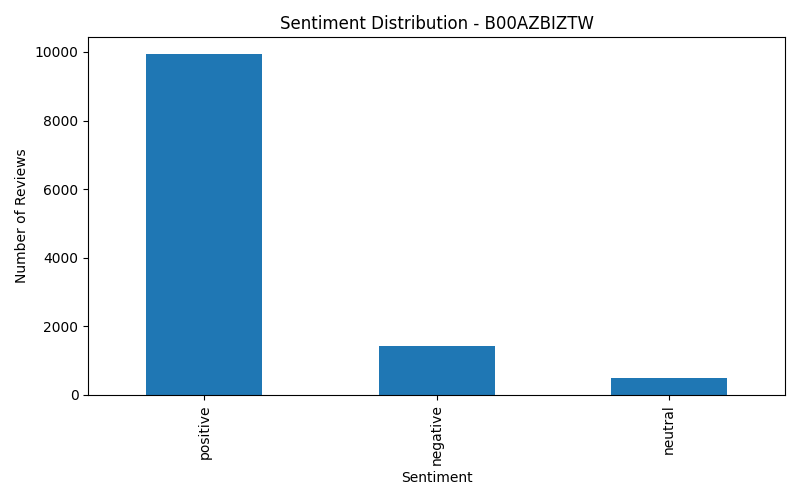
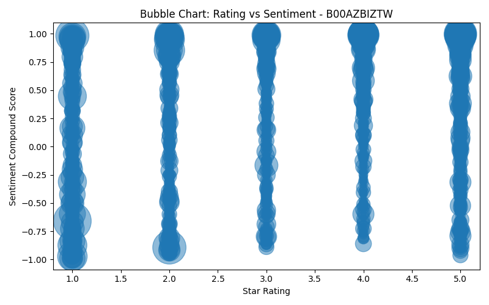
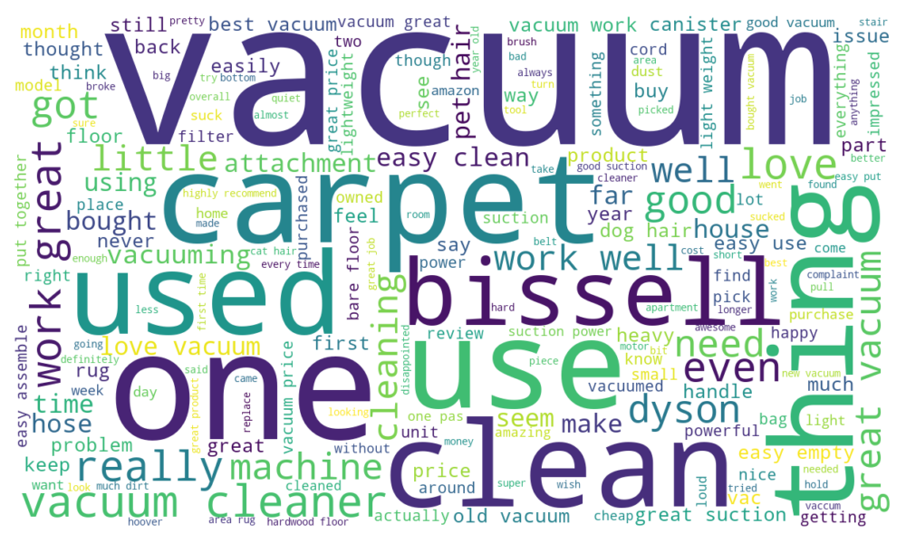
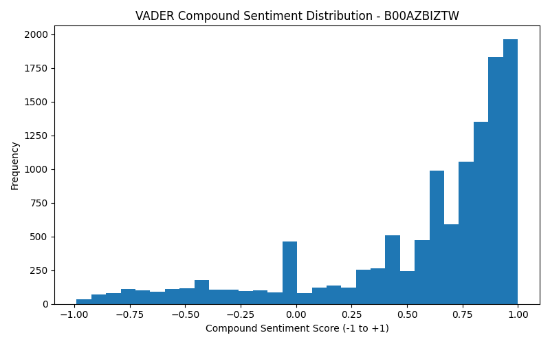
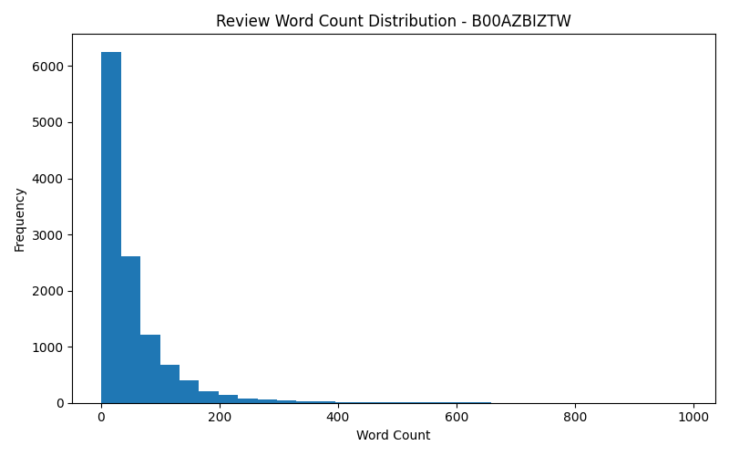

# Amazon Product Review Sentiment Analysis

**Exploratory Data Analysis (EDA) | Natural Language Processing (NLP) | Python**

An end-to-end Python project analysing customer feedback from Amazon's **Industrial & Scientific** reviews dataset. The project processes a large review collection, identifies the three most-reviewed products, and examines their ratings, written feedback, sentiment, frequently discussed topics, and review activity over time.

The aim is to turn unstructured customer comments into clear, practical insights about product performance and customer experience. This project was developed as part of my MSc in Data Science.

## Project at a glance

| Metric | Result |
|---|---:|
| Total reviews scanned | **1,758,333** |
| Reviews belonging to the three most-reviewed products | **38,275** |
| Reviews retained after cleaning | **30,344** |
| Products analysed individually | **3** |
| Processing approach | Chunked JSON Lines ingestion (**200,000 rows/chunk**) |
| Sentiment approach | NLTK **VADER**, rule-based polarity scoring |

## Questions explored

- Which products received the most reviews, and what do their star ratings indicate?
- What proportion of reviews express positive, negative, or neutral sentiment?
- Which words and two-word phrases appear most often in customers' comments?
- How do written sentiment, numerical ratings, and review length relate visually?
- How does the volume and average tone of reviews change over time?

## Tools and technologies

**Python · Pandas · NLTK · VADER SentimentIntensityAnalyzer · WordNetLemmatizer · Matplotlib · WordCloud · Regular Expressions · Collections/Counter · pathlib**

## Data and methodology

The source is the **Amazon Industrial & Scientific** review dataset, supplied in JSON Lines format (`Industrial_and_Scientific.json`) for the MSc project. Each review includes product identifiers (`asin`), star ratings (`overall`), free-text comments (`reviewText`), review dates, and other review metadata.

The analysis follows this workflow:

**1. Extract and select** — Read the large JSON Lines file in chunks of 200,000 records. Count reviews by product identifier across the full file, select the three most-reviewed ASINs, and perform a second chunked pass to load only their reviews.

**2. Validate and clean** — Check required columns, report missing values and duplicate product/text pairs, convert star ratings to numeric values, parse review timestamps, clean available vote/verification fields, remove empty reviews, and deduplicate on `asin` and `reviewText`.

**3. Prepare review text** — Lowercase text, remove URLs and non-alphabetic characters, normalise whitespace, remove English stopwords and very short tokens, and lemmatise remaining words with WordNet.

**4. Score sentiment** — Apply NLTK's VADER sentiment analyser to the *preprocessed review text*. Label compound scores as **positive (≥ 0.05)**, **negative (≤ −0.05)**, or **neutral (between −0.05 and 0.05)**.

**5. Analyse each product independently** — Calculate descriptive statistics; count common words and bigrams; aggregate monthly review volume, average rating, and average sentiment; and produce charts and CSV summaries for each ASIN.

## Results

| Product ASIN | Reviews after cleaning | Mean star rating / 5 | Mean VADER compound score | Average words / review |
|---|---:|---:|---:|---:|
| `B00DRALJ28` | 13,141 | 4.16 | +0.407 | 32.60 |
| `B00AZBIZTW` | 11,825 | 4.18 | +0.566 | 53.52 |
| `B0013BKD08` | 5,378 | 4.09 | +0.369 | 26.40 |

Across all three products, the average star ratings were above 4/5 and the average VADER compound scores were positive. These values summarise the analysed reviews; they do not establish whether a product is objectively better than another.

### Featured analysis: `B00AZBIZTW`

This product's reviews frequently mention a **vacuum cleaner**, with discussion of **carpet cleaning, suction, ease of use, and pet hair**.

The word-frequency analysis found:

| Frequent word | Occurrences |
|---|---:|
| vacuum | 13,869 |
| great | 4,870 |
| easy | 3,379 |
| carpet | 3,262 |
| suction | 2,543 |

The most frequent two-word phrases included **“vacuum cleaner” (960)**, **“work great” (859)**, **“great vacuum” (685)**, **“work well” (644)**, and **“easy clean” (554)**. These are token/phrase occurrences rather than counts of distinct reviewers.

The rating distribution is dominated by five-star reviews, while the sentiment distribution contains substantially more positive labels than neutral or negative labels. The VADER score histogram also shows a concentration towards the positive end of the −1 to +1 scale.

### Visualisations

**Rating distribution** — The number of reviews at each star-rating level.



**Sentiment distribution** — Positive, negative, and neutral review labels based on VADER compound scores.



**Rating vs. sentiment bubble chart** — Each review is plotted by its star rating and VADER score; bubble area is scaled using review word count. The chart reveals both broad agreement and individual differences between star ratings and text sentiment.



**Word cloud** — A quick visual overview of the vocabulary appearing most often in cleaned reviews.



**Sentiment score histogram** — The distribution of VADER compound scores across reviews.



**Review length histogram** — Most comments are relatively short, with a smaller number of much longer reviews.



The same analysis and chart generation process was applied separately to the other two selected products. The script also exports `monthly_trends.csv` for each ASIN, containing review counts and mean rating/sentiment by calendar month. Monthly line charts were produced separately for the academic report using these data.

## Key findings and practical implications

- **Generally positive feedback:** All three selected products have mean ratings greater than four stars and positive mean VADER sentiment scores.
- **Recurring product themes:** Frequent words and phrases help surface features customers discuss, such as suction, cleaning performance, ease of use, and monitoring/reading accuracy, depending on the product.
- **Ratings and text add different perspectives:** A star rating captures an overall judgement; sentiment analysis adds information about the tone of a written review. The bubble charts help inspect where the two measures agree or differ.
- **Review activity changes over time:** Monthly aggregation shows changes in the number of reviews posted, although it cannot establish why these changes occurred or prove seasonality, sales demand, or promotional effects.
- **Potential product improvements:** Repeated complaints and performance-related phrases can guide closer manual review of reliability and usability issues before product decisions are made.

## Repository contents

```text

amazon-reviews-sentiment-analysis/
├── README.md
├── top3_compare.py
└── outputs/
    ├── B00DRALJ28/
    │   ├── summary.csv
    │   ├── monthly_trends.csv
    │   ├── top_words.csv
    │   ├── top_bigrams.csv
    │   ├── rating_distribution.png
    │   ├── sentiment_distribution.png
    │   ├── sentiment_compound_hist.png
    │   ├── bubble_rating_vs_sentiment.png
    │   ├── review_word_count_hist.png
    │   └── wordcloud.png
    │
    ├── B00AZBIZTW/
    │   ├── summary.csv
    │   ├── monthly_trends.csv
    │   ├── top_words.csv
    │   ├── top_bigrams.csv
    │   ├── rating_distribution.png
    │   ├── sentiment_distribution.png
    │   ├── sentiment_compound_hist.png
    │   ├── bubble_rating_vs_sentiment.png
    │   ├── review_word_count_hist.png
    │   └── wordcloud.png
    │
    └── B0013BKD08/
        ├── summary.csv
        ├── monthly_trends.csv
        ├── top_words.csv
        ├── top_bigrams.csv
        ├── rating_distribution.png
        ├── sentiment_distribution.png
        ├── sentiment_compound_hist.png
        ├── bubble_rating_vs_sentiment.png
        ├── review_word_count_hist.png
        └── wordcloud.png

```
The project generates separate analytical outputs for each of the three selected Amazon products. Each product folder contains summary statistics, monthly review trends, frequently occurring words and bigrams, sentiment distributions, rating analysis, review length distributions, bubble charts, and word clouds. Organising the results by product allows the findings to be explored independently while keeping the analysis reproducible and easy to navigate.
Each ASIN folder has the same output-file structure. CSV files store summaries and frequency/trend tables; PNG files contain the plots.

## Running the analysis

**Requirements:** Python 3.11 (the version used for the project) and the packages below.

```bash
pip install pandas matplotlib nltk wordcloud
```

The script initialises the required NLTK datasets (`stopwords`, `wordnet`, and `vader_lexicon`), downloading them when needed.

1. Obtain the Amazon Industrial & Scientific reviews dataset in **JSON Lines** format and extract it if compressed.
2. In `top3_compare.py`, update the `JSON_FILE` variable inside `main()` to point to the local `Industrial_and_Scientific.json` file. The current script contains the Windows path from the original project environment.
3. Run:

```bash
python top3_compare.py
```

The program writes per-product results under `outputs/<ASIN>/`, relative to the current working directory. The raw dataset is not included in this repository.

## Limitations and next steps

- **Sentiment is an estimate, not ground truth.** VADER may miss sarcasm, specialist terminology, or mixed opinions. In this version, it scores text *after* stopword and punctuation removal, which may remove cues VADER normally uses, including negation and emphasis.
- **Simple bigram counting:** The current implementation joins cleaned reviews before extracting adjacent word pairs. This can create a small number of phrases that span review boundaries.
- **Data-cleaning caveat:** Converting `reviewText` to string before removing nulls can preserve a missing value as the literal string `"nan"`; a future revision should remove missing text first.
- **Selection bias:** The three most-reviewed products are not necessarily representative of the full Industrial & Scientific category.
- **Descriptive, not causal:** Review volume and average sentiment can be tracked by month, but the script does not test causal drivers, statistical significance, or formal seasonality.

Future improvements include scoring original review text with VADER, correcting bigram boundaries, strengthening automated quality checks, comparing sentiment with ratings more formally, and building a small interactive dashboard.

## References and attribution

- **Dataset:** Amazon Industrial & Scientific review data, provided for MSc Data Science coursework. The underlying dataset is not redistributed here.
- **VADER:** Hutto, C. J., & Gilbert, E. (2014). *VADER: A Parsimonious Rule-Based Model for Sentiment Analysis of Social Media Text*. [DOI](https://doi.org/10.1609/icwsm.v8i1.14550).
- **NLTK:** Bird, S., Klein, E., & Loper, E. (2009). *Natural Language Processing with Python*. O'Reilly Media.

---

*Project developed as part of an MSc in Data Science, demonstrating practical experience in Python data processing, EDA, NLP, sentiment analysis, and communicating results through visualisations.*
